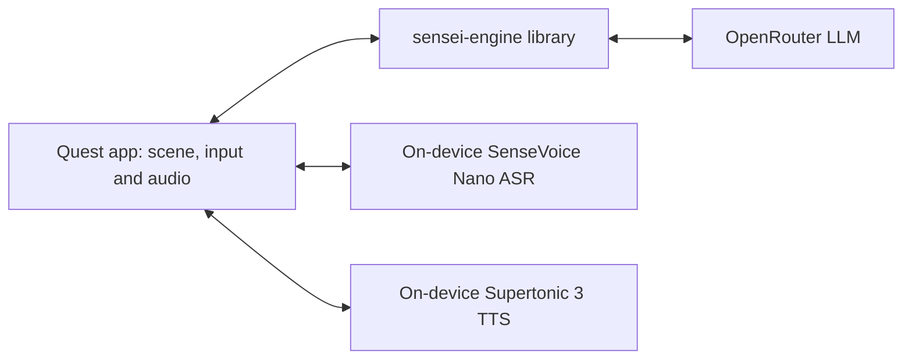

# Red Panda Sensei

Red Panda Sensei is a mixed-reality Japanese practice companion for Quest. A ghostly red panda guides conversations and activities with a tabletop of cardboard standees, adapting support to the learner while an AI game master controls the scene and tracks practice.

## In the headset

Sensei greets you beside a practice area in passthrough. Select a card with the right trigger; grab it with the right grip and release it over a region or container. Hold **A** to talk, **B** to repeat, **X** for a hint, and tap **Y** for the menu. Hold **Y** for one second to re-place the area; click the left stick to toggle slower speech.



Speech recognition and synthesis run on the headset; recognized text and game context go to the LLM provider.

## Try it

Enable Quest developer mode and USB debugging, connect the headset, and authorize the computer. Install a release APK downloaded separately:

```bash
adb install -r <release.apk>
bash tools/unity/push-env.sh
```

`push-env.sh` takes the OpenRouter key from `SENSEI_LLM_API_KEY` if it is set; otherwise it asks for it (input hidden). The key is streamed to the headset's `sensei.env` in the app's external files directory; no key file is written on your computer. Set `QUEST_SERIAL` if several devices are connected.

```bash
SENSEI_LLM_API_KEY=<your-key> bash tools/unity/push-env.sh   # or run it without the variable and type the key
```

Then launch Red Panda Sensei in the headset. An internet connection and a working OpenRouter key are needed for conversation.

## Build it

On macOS, install Unity **6000.6.5f1** with Android Build Support (SDK, NDK and OpenJDK), the **.NET 10 SDK**, Android Platform Tools (`adb`), and `uv`. OpenXR 1.19.0 and Meta XR Core 207.0.1 are pinned in the project. From the repository root:

```bash
bash tools/unity/sync-engine.sh
bash tools/unity/fetch-voice-models.sh
bash tools/unity/build-android.sh
bash tools/unity/push-env.sh
bash tools/unity/run-quest.sh
```

The build script also syncs engine and art. Models are downloaded and verified before inclusion in StreamingAssets. The APK is `unity/RedPandaSensei/Build/RedPandaSensei.apk`. Set `UNITY_EDITOR` to override the editor path. The run script installs and launches the build and checks boot and the initial turn; it temporarily pauses the Guardian boundary for a desk test and restores it on exit. Use the headset normally with its boundary enabled.

## Engine CLI

With .NET 10 installed, set `SENSEI_LLM_API_KEY` in your shell to an OpenRouter key and run:

```bash
dotnet run --project sensei-engine/src/Sensei.Engine.Cli
```

Type a message and press Enter to talk. `/help` lists commands; `/scene` shows the scene, `/profile` shows the developer view, and `/quit` exits. The CLI stores profiles and traces under `./.sensei` by default. See [engine specification](sensei-engine/SPEC.md) for options and provider settings.

## Development only

These hooks are for test builds and diagnostics, not normal play. Values belong in the headset's `sensei.env` unless stated otherwise; test audio must be in StreamingAssets before building.

| Hook | Purpose |
|---|---|
| `RPS_DEBUG_TEXT=1` | Log a redacted transcript. |
| `RPS_TEST_TURN` | Send a test turn after the greeting; `push-env.sh --test-turn "text"` provisions it. |
| `RPS_TEST_AUDIO` | Use a named PCM16 WAV from StreamingAssets for the first push-to-talk. |
| `RPS_TEST_PTT_SECONDS` | Automatically hold talk for the specified seconds. |
| `RPS_TEST_INTERRUPT_MS` | Trigger that hold during speech after the specified milliseconds. |
| `RPS_TEST_FRAME=sensei` | Frame Sensei and caption for unattended capture. |
| `RPS_TEST_MENU=1` | Open the menu at boot. |
| `RPS_EXPECT_TEST_TURN=1` | Host environment variable: make `run-quest.sh` wait for the test turn. |

## Status and limits

The voice test corpus uses synthetic macOS speech, so it does not establish performance across real speakers and environments. Mixed Japanese-English utterances are a weak point for ASR. Device turns have taken roughly 20 seconds; latency varies with speech, model and network. See [Quest specification](unity/SPEC.md) for measured voice results and current implementation details.

## Repository

- `sensei-engine/` — game-master library, CLI, tests and specification.
- `unity/` — Quest app, speech packages, notices and specification.
- `tools/unity/` — build, model and device scripts.
- `assets/sprites/` — source artwork and checksums; see [asset provenance](docs/ASSETS.md).
- `docs/prd/` — original product requirements; engine and Unity specs supersede conflicting details.
- [Third-party components and licences](docs/THIRD_PARTY.md).
