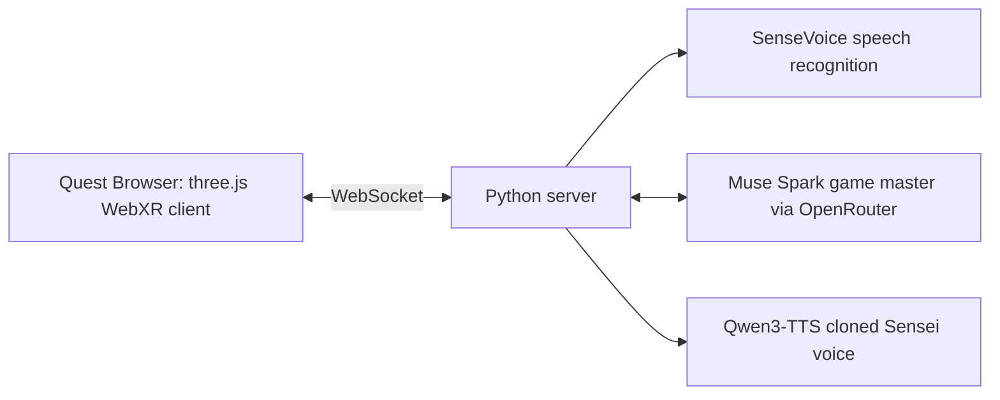

# Red Panda Sensei

Red Panda Sensei is a mixed-reality Japanese practice companion for Meta Quest. A ghostly red panda stands beside a small practice area in passthrough, talks with you in Japanese and English, and runs short activities with cardboard-style objects. An AI game master decides what Sensei says and does, adapts to your level, and tracks your practice.

It runs as a WebXR app: open a URL in the Quest Browser, no install needed.

## Built with Meta Muse

Muse.ai, Muse Wonder, Muse Video gen and Muse Spark were used both to develop Red Panda Sensei and to run it.

- **Muse Spark** is Sensei's game master at runtime. Every reply, scene change, task and progress record comes from Muse Spark (`meta/muse-spark-1.3-contributor`, called through OpenRouter).
- **Muse.ai, Muse Wonder and Muse Video gen** were used during development of the app and its content.

## Play it

1. Put the Quest on the same Tailscale network as the machine running the server (see [Run it](#run-it)).
2. Open the URL that `make up` prints (for example `https://<machine>.<tailnet>.ts.net/`) in the Quest Browser.
3. Tap **Start session**, then **Enter AR**.
4. Talk to Sensei. Tell it how much Japanese you know; beginners get a first small task, such as asking for the water in Japanese (みずをください).

| Action | Controllers | Hands | Desktop |
|---|---|---|---|
| Talk | hold right **A** | pinch and hold (not on an object) | hold **Space** or the Hold to talk button |
| Grab and move an object | right grip, release over a spot or container | pinch while pointing at the object, release to drop | drag with the mouse |
| Repeat Sensei's last line | right **B** | not mapped | **R** |
| Hint | left **X** | not mapped | **H** |
| Menu (level, English help, summary, reset) | left **Y** | not mapped | **M** |

With hands only, repeat, hint and the menu are not mapped yet; pick up a controller for them. The desktop page works in any browser without a headset, which is useful for trying the conversation and for development.

## How it works



- `client/`: Vite + TypeScript + three.js WebXR client. Sensei is drawn from pre-generated video loops; objects are image cutouts; captions sit above Sensei.
- `server/`: FastAPI + PydanticAI. It receives push-to-talk audio, recognises it with SenseVoice, runs the game master on Muse Spark, and streams Sensei's speech back sentence by sentence.
- `web/`: the wire protocol ([PROTOCOL.md](web/PROTOCOL.md)) and product spec ([SPEC.md](web/SPEC.md)) shared by client and server.

Speech recognition and speech synthesis run on the server machine. Recognised text and game context go to Muse Spark.

## Run it

Needs macOS or Linux with Node.js (npm), [uv](https://docs.astral.sh/uv/), and the [Tailscale](https://tailscale.com/) CLI logged in. WebXR and the microphone require HTTPS; `make up` publishes the server over Tailscale HTTPS for that reason.

```bash
cp .env.example .env   # then fill in SENSEI_LLM_API_KEY and VOICE_REF
make up
```

The Makefile reads `.env` next to it (gitignored; `KEY=value` lines, no quotes). Values given on the command line (`make up PORT=8010`) override `.env`. If the key is empty, `make up` asks for it (input hidden).

`make up` installs dependencies, builds the client, starts the server in the background, waits until it is healthy, publishes it with `tailscale serve`, and prints the URL to open. The first start downloads the speech models and warms up the voice, which can take several minutes.

| Command | What it does |
|---|---|
| `make up` | build, start in the background, publish over Tailscale HTTPS |
| `make down` | remove the Tailscale route and stop the server |
| `make status` | server health and Tailscale routes |
| `make logs` | follow the server log (`.run/server-<port>.log`) |
| `make run` | run the server in the foreground (no tunnel) |
| `make url` | print the URL again |

Variables: `PORT` (default 8000), `HTTPS_PORT` (default 443), `VOICE_REF` (reference WAV for Sensei's cloned voice; without it the app runs captions-only), `PROFILE_DIR` (learner profiles, default `.run/profiles`). The key is passed only to the server process environment and is never written to disk. More server settings: [server/README.md](server/README.md).

## Status and limits

- A turn takes several seconds: speech recognition, the game-master call and voice synthesis run one after another. Beginner turns that create an object and start a task have taken 30–40 seconds on an M1 Pro.
- The server machine must stay on and reachable while you play.
- Mixed Japanese-English utterances are a weak point for speech recognition.
- Hand grabbing is covered by unit tests; it has not yet been checked in a headset.

## Unity prototype (v0.1.2, frozen)

The first build was a native Unity Quest app (releases v0.1.0 to v0.1.2). It is frozen and kept for reference: it supports controllers only and runs speech on the headset. Build and device instructions are in [unity/README.md](unity/README.md) and [unity/SPEC.md](unity/SPEC.md); the C# game-master library and its CLI are in [sensei-engine/](sensei-engine/SPEC.md).

## Repository

- `client/`: WebXR client.
- `server/`: WebXR server.
- `web/`: protocol and product spec.
- `tools/web/`: run and publish script used by the Makefile.
- `sensei-engine/`, `unity/`, `tools/unity/`: the frozen Unity prototype and its C# game-master library.
- `assets/sprites/`: source artwork and checksums; see [asset provenance](docs/ASSETS.md).
- `docs/prd/`: original product requirements; the specs supersede conflicting details.
- [Third-party components and licences](docs/THIRD_PARTY.md).
